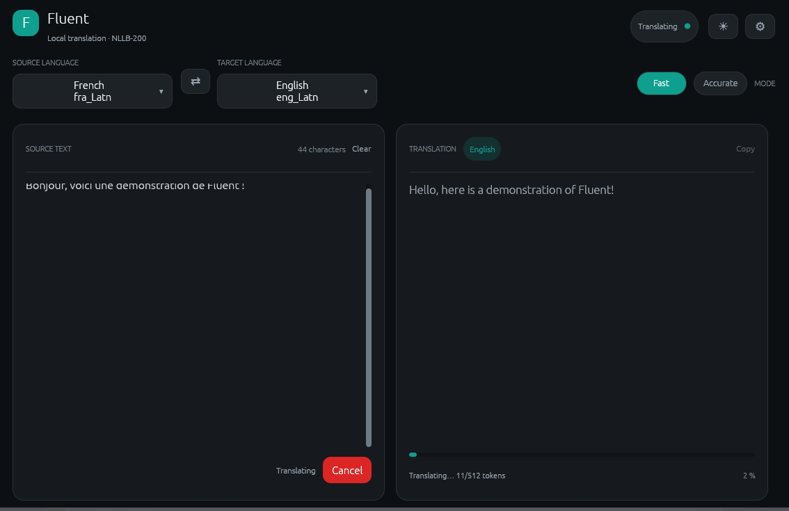
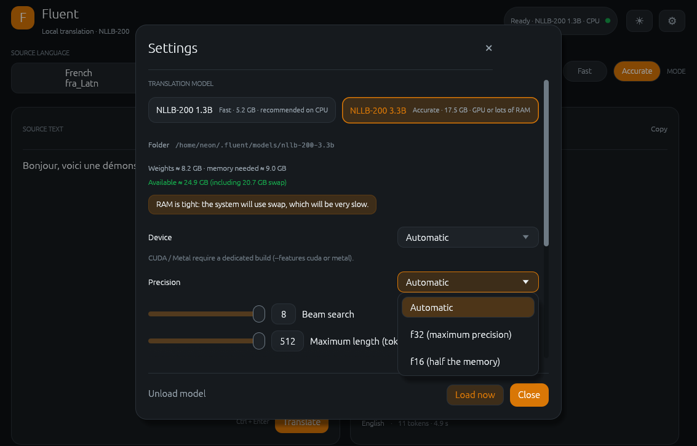

# ✦ Fluent

**Private AI translation. No cloud. Your machine.**

A native, local-first translation application powered by Meta's NLLB-200 models — built in Rust for Linux, Windows, and macOS.

Translate across **190+ languages and dialects** with a clean desktop interface, selectable translation modes, and optional GPU acceleration.

[](https://www.rust-lang.org/) [](#-features) [](https://github.com/facebookresearch/fairseq/tree/nllb) [](LICENSE)

---

## ◈ Preview





*Powerful translation. A native interface. Your data stays yours.*

---

## ✦ Features

| Feature | Description |
| --- | --- |
| 🌍 **190+ languages** | Translate between a wide range of languages and dialects. |
| 🧠 **Local AI inference** | Run NLLB-200 models directly on your computer. |
| ⚡ **Fast mode** | Use the smaller 1.3B model for lighter workloads. |
| 🎯 **Accurate mode** | Choose the larger 3.3B model for translation quality. |
| 🔎 **Automatic detection** | Detect the source language automatically. |
| 🖥️ **Native desktop UI** | A responsive interface built with Rust and egui. |
| 🎨 **Customizable appearance** | Light, dark, and system themes, plus accent colors. |
| 🚀 **Optional GPU acceleration** | CUDA on supported NVIDIA systems or Metal on Apple Silicon. |
| 🔒 **Local-first privacy** | Translation inference runs on your device, without a cloud translation API. |
| 🧩 **Self-contained installation** | Install the executable, configuration, and model directories under your chosen installation folder. |

## ▸ Getting Started

### Requirements

- Rust 1.85 or newer and Cargo.
- A C toolchain for native dependencies.
- Sufficient disk space and memory for the model you intend to use.
- On Linux, the required X11 or Wayland development libraries and an OpenGL driver when building from source.

The installer builds the desktop application, but **does not download model weights**. You must provide the supported model files separately.

### 1. Clone the repository

```bash
git clone https://github.com/NeonMC23/Fluent.git
cd Fluent
```

### 2. Run the installer

```bash
chmod +x install.sh
./install.sh
```

By default, Fluent installs under `~/.fluent`.

The installer builds the GUI in release mode, installs the executable, creates the model directories, and copies or hard-links available model files from the repository's `models/` directory.

### 3. Add the models

Fluent supports two translation engines:

| Mode | Model | Approximate weights | Intended use |
| --- | --- | ---: | --- |
| ⚡ **Fast** | `facebook/nllb-200-1.3B` | 5.2 GB | Lower-memory systems |
| 🎯 **Accurate** | `facebook/nllb-200-3.3B` | 17.5 GB | Systems with more memory or GPU resources |

Place each model's files in the corresponding directory:

```text
~/.fluent/
├── bin/
│   └── fluent
├── config.json
└── models/
    ├── nllb-200-1.3b/
    └── nllb-200-3.3b/
```

Each model directory must contain the required model configuration, tokenizer, and supported checkpoint files. Sharded checkpoints are supported.

If the installer did not find models in the repository, place them in the installed `models/` directory after installation.

### 4. Launch Fluent

```bash
~/.fluent/bin/fluent
```

The models are loaded on demand when you perform your first translation.

### Installer options

| Option | Purpose |
| --- | --- |
| `--cuda` | Build with NVIDIA CUDA support; requires the CUDA toolkit and `nvcc`. |
| `--metal` | Build with Metal support for Apple Silicon. |
| `--skip-build` | Reuse an existing `target/release/fluent` binary. |
| `--skip-models` | Create empty model directories without installing models. |
| `--install-dir DIR` | Choose a custom installation directory. |

You can also override the model source and installation location:

```bash
FLUENT_MODELS_SRC=/path/to/models ./install.sh
FLUENT_INSTALL_DIR=/path/to/install ./install.sh
```

## ⌁ Using Fluent

1. Select a source language or leave automatic detection enabled.
2. Choose your target language using the searchable language selector.
3. Enter or paste the text you want to translate.
4. Click **Translate** or press `Ctrl + Enter`.
5. Copy the translated result when you're ready.

The interface displays model-loading and generation progress. Operations can be cancelled while loading or generating.

## ⚙️ Configuration

Fluent stores application settings separately from the model files.

| Platform | Settings location |
| --- | --- |
| Linux | `~/.config/fluent/settings.json` |
| Windows | `%APPDATA%\fluent\Fluent\settings.json` |
| macOS | `~/Library/Application Support/io.fluent.Fluent/settings.json` |

The root `config.json` defines model paths and generation defaults. For an installed copy, the application uses the configuration associated with its installation directory.

Example:

```json
{
  "models": {
    "fast": "models/nllb-200-1.3b",
    "accurate": "models/nllb-200-3.3b"
  },
  "generation": {
    "max_length": 512,
    "num_beams": 4
  }
}
```

## 🚀 GPU Acceleration

Fluent runs on the CPU by default. Optional acceleration can be enabled at build time.

### NVIDIA — CUDA

```bash
cargo build --release -p fluent-gui --features cuda
```

Requires a compatible NVIDIA GPU, CUDA toolkit, and `nvcc`.

### Apple Silicon — Metal

```bash
cargo build --release -p fluent-gui --features metal
```

Requires a supported Apple Silicon environment.

When the corresponding feature is enabled, select the desired device in **Settings → Device**. Otherwise, use CPU inference.

## 🛠️ Building from Source

### Linux — Fedora / Nobara

Install the required system packages:

```bash
sudo dnf install gcc gcc-c++ make cmake \
    libxkbcommon-devel wayland-devel mesa-libGL-devel \
    fontconfig-devel
```

Build and run:

```bash
cargo build --release -p fluent-gui
./target/release/fluent
```

### Windows

Install Rust and the MSVC C++ build tools, then run:

```powershell
cargo build --release -p fluent-gui
.\target\release\fluent.exe
```

### macOS

Install Xcode Command Line Tools and Rust:

```bash
cargo build --release -p fluent-gui
./target/release/fluent
```

### CLI example

The core crate also includes a command-line translation example:

```bash
cargo run --release -p fluent-core --example translate -- \
    "Hello, how are you?" eng_Latn fra_Latn models/nllb-200-1.3b \
    cpu auto
```

Optional environment variables:

- `FLUENT_BEAMS` — beam width; defaults to `4`.
- `FLUENT_MAX_NEW` — maximum number of generated tokens.

## ⛭ Technology

| Component | Technology |
| --- | --- |
| Language | Rust |
| Desktop interface | egui / eframe |
| Inference engine | Candle |
| Translation models | Meta NLLB-200 |
| Tokenization | Hugging Face `tokenizers` |
| Language detection | `whatlang` |
| Configuration | JSON and Serde |
| GPU acceleration | Optional CUDA / Metal |

The Rust application is independent of the legacy Python backend and web frontend, which remain in the repository for reference.

## 🔒 Privacy by Design

Fluent is designed to keep translation local.

- **No cloud translation API** is required for inference.
- **No account** is needed.
- **No dedicated application backend** is required by the native translation engine.
- **Your text stays on your device** during local inference.
- **Model downloads require network access**, but translation itself can run offline once the required files are available.

Your operating system and other software may still have their own network activity; Fluent's local inference does not mean the entire machine is offline.

## 🗺️ Roadmap

Potential future improvements:

- [ ] More model choices and inference optimizations.
- [ ] Additional interface customization.
- [ ] Improved model management and setup guidance.
- [ ] Further performance and usability refinements.

These are possible future directions, not promises of features already implemented.

## 🤝 Contributing

Contributions, bug reports, and suggestions are welcome.

- Report bugs and unexpected translation results.
- Suggest interface and usability improvements.
- Help improve documentation and cross-platform support.
- Propose performance optimizations.

For substantial changes, open an issue to discuss the approach before submitting a pull request.

## 📄 License

Fluent is distributed under the [MIT License](LICENSE).

---

*Your language. Your machine. Your privacy.*

**Fluent — Translation without the cloud.**