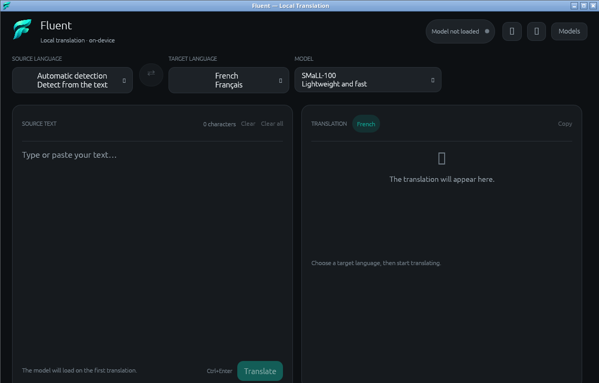

# ✦ Fluent

**Private AI translation. No cloud. Your machine.**

_Development version 0.2.0 · last published 0.1.0_

A native, local-first translation application powered by NLLB-200, MADLAD-400 and SMaLL-100 — built in Rust for Linux, Windows, and macOS.

Translate across **190+ languages and dialects** with a clean desktop interface, selectable translation modes, and optional GPU acceleration.

[](https://www.rust-lang.org/) [](#-features) [](https://github.com/facebookresearch/fairseq/tree/nllb) [](LICENSE)

<p align="center"></p>

---

## ◈ Preview



*Powerful translation. A native interface. Your data stays yours.*

---

## ✦ Features

| Feature | Description |
| --- | --- |
| 🌍 **200+ languages** | NLLB-200 covers 202 language and script variants. |
| 🧠 **Local AI inference** | Run translation and chat models locally, without a server or cloud API. |
| 💬 **Local chat** | A separate Qwen2.5 Instruct model for on-device conversation, with streaming and cancellation. |
| 🧬 **Three model families** | Choose NLLB-200 for broad coverage, MADLAD-400 for T5 translation, or SMaLL-100 for a fast 330M CPU model. |
| 🌐 **Accurate language lists** | The source and target pickers show only the languages the selected model can actually translate. |
| 📦 **Model Manager** | Detect, download, verify, load and safely remove models from the desktop app. |
| ⚡ **NLLB-200 1.3B** | Balanced CPU translation with a 1.3B-parameter model. |
| 🎯 **NLLB-200 3.3B** | Higher-quality, resource-intensive translation; CPU auto uses Q8. |
| 🔎 **Automatic detection** | Detect the source language automatically. |
| 🖥️ **Native desktop UI** | A responsive interface built with Rust and egui. |
| 🎨 **Customizable appearance** | Light, dark, and system themes, plus accent colors. |
| 🚀 **Optional GPU acceleration** | CUDA on supported NVIDIA systems or Metal on Apple Silicon. |
| 🔒 **Local-first privacy** | Translation and chat inference run on your device; chat history is session-only. |
| 🧩 **Clean per-user installation** | The application, configuration, and models live in separate, predictable locations. Uninstall never deletes your models or settings. |

## ▸ Getting Started

### Requirements

- Rust 1.85 or newer and Cargo, plus `bash` for the installer.
- A C/C++ toolchain, `pkg-config` and `cmake` for native dependencies.
- Sufficient disk space and memory for the model you intend to use.
- On Linux, X11 or Wayland development libraries and an OpenGL 3.3-capable driver when building from source.
- On Windows and macOS, see the platform guides linked below. Linux is the validated target; Windows and macOS have not been runtime-tested.

The installer builds the desktop application, but **does not download model weights**. You must provide the supported model files separately, or use the native Model Manager after installation. NLLB licensing is documented in [docs/MODEL_PROVENANCE.md](docs/MODEL_PROVENANCE.md); MADLAD acquisition, the pinned q4_k file and Apache-2.0 licensing are documented in [docs/MADLAD.md](docs/MADLAD.md); the lightweight SMaLL-100 model, its MIT licence and its 98-language mapping are documented in [docs/SMALL100.md](docs/SMALL100.md).

### 1. Clone the repository

```bash
git clone https://github.com/NeonMC23/Fluent.git
cd Fluent
```

### 2. Run the installer

```bash
chmod +x install.sh
./install.sh
```

On Linux the default layout separates each kind of file:

```text
~/.local/lib/fluent/fluent                 application
~/.local/bin/fluent                        launcher
~/.config/fluent/config.json               configuration (user-owned)
~/.config/fluent/settings.json             preferences
~/.local/share/fluent/models/              models (user-owned)
~/.local/share/applications/io.fluent.Fluent.desktop
```

`XDG_CONFIG_HOME`, `XDG_DATA_HOME` and `XDG_STATE_HOME` are respected. The
installer requires no root privileges, is safe to run again, preserves existing
configuration and models, and never deletes user data. See
[docs/LINUX.md](docs/LINUX.md) for the full Linux guide.

### 3. Add the models

Fluent supports four translation choices across three model families:

| Model | Upstream | Approximate storage | Intended use |
| --- | --- | ---: | --- |
| ⚡ **NLLB-200 1.3B** | `facebook/nllb-200-1.3B` | 5.2 GB | Balanced CPU translation |
| 🎯 **NLLB-200 3.3B** | `facebook/nllb-200-3.3B` | 17.5 GB | Higher-quality, resource-intensive translation |
| 🧬 **MADLAD-400 3B** | `google/madlad400-3b-mt` q4_k | 1.7 GB | Alternative multilingual translation model |
| 🪶 **SMaLL-100** | `alirezamsh/small100` | 1.3 GB | Lightweight and fast |

Chat uses separate instruct models:

| Chat model | Upstream | Approximate storage | Intended use |
| --- | --- | ---: | --- |
| 💬 **Qwen2.5 1.5B Instruct** | `Qwen/Qwen2.5-1.5B-Instruct-GGUF` Q4_K_M | 1.1 GB | Better-quality local chat |
| ⚡ **Qwen2.5 0.5B Instruct** | `Qwen/Qwen2.5-0.5B-Instruct-GGUF` Q4_0 | 0.4 GB | Fastest local chat |

> **Model licenses:** Meta releases the NLLB-200 weights under
> **CC BY-NC 4.0 (non-commercial)**. MADLAD-400 is **Apache-2.0**. SMaLL-100 is
> released under the **MIT** licence by its authors. Qwen2.5 Instruct is
> **Apache-2.0**. Fluent's MIT license covers the application code only. Fluent
> does not bundle or redistribute model weights. See [docs/MODEL_PROVENANCE.md](docs/MODEL_PROVENANCE.md),
> [docs/MADLAD.md](docs/MADLAD.md) and [docs/SMALL100.md](docs/SMALL100.md).
> CPU, quality and memory measurements are in
> [docs/BENCHMARKS.md](docs/BENCHMARKS.md).

This repository intentionally contains **no** model weights, tokenizer, or
model configuration files. Place each model's files in the corresponding
directory:

```text
~/.local/share/fluent/models/
├── nllb-200-1.3b/
│   ├── config.json
│   ├── tokenizer.json
│   └── pytorch_model.bin   (or safetensors / sharded checkpoint)
├── nllb-200-3.3b/
├── madlad400-3b-mt/
│   ├── config.json
│   ├── tokenizer.json
│   └── model-q4k.gguf
└── qwen2.5-1.5b-instruct/
    ├── qwen2.5-1.5b-instruct-q4_k_m.gguf
    ├── tokenizer.json
    └── tokenizer_config.json
```

The native **Model Manager** can download and verify the four translation
models and the two chat models. Open **Models** in the application header (or
**Settings → Manage models…**), choose a model, review its license and download
size, and confirm. Existing model directories are detected without moving or
downloading them again. See [docs/MODEL_MANAGER.md](docs/MODEL_MANAGER.md).

To use chat, select **Chat** in the header, install either Qwen2.5 Instruct
model under **Models → Chat models**, and type a message. Chat is separate from
translation: changing the chat model never changes the translation model, and
chat history is session-only. See [docs/CHAT.md](docs/CHAT.md).

The MADLAD command-line acquisition remains available as an optional fallback:

```bash
python3 scripts/fetch-madlad.py
```

Each model directory must contain `config.json`, `tokenizer.json`, and the
supported checkpoint files. Sharded checkpoints are supported; extra files from
a Hugging Face download are ignored. The installer validates the package and
refuses to install placeholder-only directories. See
[docs/MODEL_PACKAGE.md](docs/MODEL_PACKAGE.md) for the exact contract.

Alternatively, point the installer at an existing model source:

```bash
./install.sh --models-src /path/to/models
```

A legacy `~/.fluent/models` directory is detected automatically and used as a
read-only source. The old directory is never modified or deleted.

### 4. Launch Fluent

```bash
~/.local/bin/fluent
```

Or launch **Fluent** from the desktop application menu. The models are loaded
on demand when you perform your first translation. The GUI starts even when no
model is installed and shows an actionable error on the first translation.

### Portable archive (Linux)

For a no-install layout, build the application archive locally:

```bash
./scripts/package-linux.sh
sha256sum -c dist/fluent-*-linux-*.tar.gz.sha256
tar -xzf dist/fluent-*-linux-*.tar.gz
cd fluent-*-linux-*/
./bin/fluent
```

The archive contains only the executable, `LICENSE` and a runtime README. It
does not include models or tokenizer assets. The canonical build targets
Ubuntu 22.04 / glibc 2.35. See [docs/LINUX.md](docs/LINUX.md) for details.

### Uninstall

```bash
./uninstall.sh
```

This removes the application, launcher, desktop entry and installer-provided
icon. It always preserves `config.json`, `settings.json` and the model
directory. See [docs/LINUX.md](docs/LINUX.md) for migration from the old
`~/.fluent` layout.

### Installer options

| Option | Purpose |
| --- | --- |
| `--cuda` | Build with NVIDIA CUDA support; requires the CUDA toolkit and `nvcc`. |
| `--metal` | Build with Metal support (macOS only). |
| `--binary FILE` | Install a prebuilt executable instead of building. |
| `--skip-build` | Reuse an existing `target/release/fluent` binary. |
| `--models-src DIR` | Model source containing `nllb-200-1.3b/` and `nllb-200-3.3b/` (the repository default `./models` is empty in a fresh checkout). |
| `--skip-models` | Create empty model directories only. |
| `--icon FILE` | Install an SVG or PNG icon; the bundled 256×256 Fluent icon is used by default. |
| `--no-desktop` | Skip desktop integration. |
| `--reset-config` | Regenerate `config.json` (otherwise preserved). |
| `--uninstall` | Same as `uninstall.sh`; preserves configuration and models. |
| `--app-dir`, `--bin-dir`, `--config-dir`, `--models-dir` | Override individual locations. |
| `--install-dir DIR` | Legacy alias for `--app-dir`. |

## ⬇️ Downloads and CI artifacts

There is no public GitHub Release for the unreleased `0.2.0` development
version. Test builds are produced as **GitHub Actions workflow artifacts**:

1. Open <https://github.com/NeonMC23/Fluent/actions>.
2. Choose **CI and build artifacts** and a successful run.
3. Download `fluent-linux-x86_64`, `fluent-windows-x86_64`,
   `fluent-macos`, or the combined `fluent-release-candidate` artifact
   from the run summary. They expire after 14 days.

These are not release assets. Successful runs include
[43605074905](https://github.com/NeonMC23/Fluent/actions/runs/43605074905)
(code commit `ae1dfcb`), the documentation follow-up
[43606018556](https://github.com/NeonMC23/Fluent/actions/runs/43606018556),
the final path-remapping build
[43606646499](https://github.com/NeonMC23/Fluent/actions/runs/43606646499)
(`af7dbca`), the Cycle 11 packaged-smoke run
[43621221912](https://github.com/NeonMC23/Fluent/actions/runs/43621221912)
(`09a71e9`), the Cycle 12 `main` run
[43658280679](https://github.com/NeonMC23/Fluent/actions/runs/43658280679)
(`8186e04`), the Cycle 13 MADLAD run
[43666915254](https://github.com/NeonMC23/Fluent/actions/runs/43666915254)
(`e5fda1f`), the Cycle 14 quality/performance run
[43682638997](https://github.com/NeonMC23/Fluent/actions/runs/43682638997)
(`d554f5d`), the Cycle 15 Model Manager run
[43710941404](https://github.com/NeonMC23/Fluent/actions/runs/43710941404)
(`6f06329`), the Cycle 16 SMaLL-100/catalogue run
[43727254932](https://github.com/NeonMC23/Fluent/actions/runs/43727254932)
(`5200ab5`), and the Cycle 17 branding/language run
[43747547053](https://github.com/NeonMC23/Fluent/actions/runs/43747547053)
(`23a7c94`): Linux, Windows, macOS and the aggregate release candidate all
passed. The Linux artifact is an application-only tar.gz;
Windows is a portable ZIP; macOS is an `.app` ZIP whose filename records the
runner architecture (the current `macos-latest` matrix produces arm64). Models
are never included. Every build supports:

```bash
fluent --version          # version, OS and architecture
fluent --self-test        # icon, config, language and model checks
fluent --smoke-test-gui   # open a window, paint once and exit
```

The Minisign public key is committed at `docs/keys/minisign.pub` (key ID
`B504F2189BB21013`). CI artifacts are currently **unsigned** until the
`MINISIGN_SECRET_KEY` Actions secret is configured. Verify checksums and, when
present, signatures with [docs/RELEASE.md](docs/RELEASE.md).

## ⌁ Using Fluent

1. Select a source language or leave automatic detection enabled.
2. Choose your target language using the searchable language selector.
3. Enter or paste the text you want to translate.
4. Click **Translate** or press `Ctrl + Enter`.
5. Copy the translated result when you're ready.

The interface displays model-loading and generation progress. Operations can be cancelled while loading or generating.

## ⚙️ Configuration

Fluent stores application settings separately from the model files.

| Platform | Settings location |
| --- | --- |
| Linux | `~/.config/fluent/settings.json` |
| Windows | `%APPDATA%\fluent\Fluent\config\settings.json` |
| macOS | `~/Library/Application Support/io.fluent.Fluent/settings.json` |

For an installed copy, `config.json` lives in the platform configuration directory and is user-owned: the installer writes it once and leaves it untouched on later runs (`--reset-config` regenerates it). The root `config.json` is the development default used when running from the source tree.

Example:

```json
{
  "models": {
    "fast": "/home/you/.local/share/fluent/models/nllb-200-1.3b",
    "accurate": "/home/you/.local/share/fluent/models/nllb-200-3.3b",
    "madlad": "/home/you/.local/share/fluent/models/madlad400-3b-mt",
    "small": "/home/you/.local/share/fluent/models/small100",
    "chat": "/home/you/.local/share/fluent/models/qwen2.5-1.5b-instruct"
  },
  "generation": {
    "max_length": 512,
    "num_beams": 4,
    "unlimited_output": false
  }
}
```

The application searches `FLUENT_CONFIG`, the executable directory and its
parent, the platform configuration directory, then the current directory.

`max_length` is the maximum number of **source** tokens; longer input is truncated explicitly and flagged in the interface.

Generated output is controlled by the **Output limit** setting in Settings or by `config.json`:

- **Automatic** (default): derives a finite budget from the input (`min(512, source_tokens * 2 + 16)`) so short sentences finish quickly. This preserves the previous behavior.
- **Custom limit**: uses `"max_new_tokens": N` as a finite ceiling, even if the model has not emitted EOS. Requests are capped by the model’s positional capacity.
- **No limit**: set `"unlimited_output": true`. Fluent imposes no token ceiling and generates until EOS, cancellation, an inference error, or the model's capacity. For NLLB's 1024-position table this is about 1022 generated tokens after the two prompt tokens; MADLAD has no fixed positional cap, so memory and time are the practical limits. Long outputs require more memory and time; it is not infinite hardware capacity.

Existing configuration files without these fields remain on **Automatic**. The GUI persists the selected mode in `settings.json`.

## 🚀 GPU Acceleration

Fluent runs on the CPU by default. Optional acceleration can be enabled at build time.

### NVIDIA — CUDA

```bash
cargo build --release -p fluent-gui --features cuda
```

Requires a compatible NVIDIA GPU, CUDA toolkit, and `nvcc`.

### Apple Silicon — Metal

```bash
cargo build --release -p fluent-gui --features metal
```

Requires a supported Apple Silicon environment.

When the corresponding feature is enabled, select the desired device in **Settings → Device**. Otherwise, use CPU inference.

## ⚡ CPU Performance

On CPU, Fluent keeps the model weights in memory as 8-bit blocks (Q8) instead of f32. A block of 32 values shares one f32 scale, which cuts weight traffic and resident memory by about 3.5×. The inner loop is an integer `i8 × i8` multiply-accumulate; the block result is then scaled in f32, so accuracy stays close to the f32 reference at block granularity. On x86-64 an AVX2/FMA kernel is selected at runtime when the processor supports it; a portable scalar kernel is always available, so the build does not require a particular instruction set.

- The model file on disk is **never modified**. Quantization happens once while loading and the f32 weights are released immediately.
- The Q8 path is used automatically only for CPU inference in f32. CUDA, Metal and explicit f16 keep the existing path.
- Encoder prefill processes eight source rows per quantized weight-block traversal, which keeps the activation tile in cache and cut encoder time by about 20% on the reference machine.
- Decoding uses a fused attention kernel and a preallocated per-beam KV cache instead of rebuilding and broadcasting tensors every step. Logits are normalized on demand with a bit-identical log-sum-exp, so the full vocabulary is never materialized during beam search.

Two environment overrides are available for diagnosis:

| Variable | Effect |
| --- | --- |
| `FLUENT_QUANT=off` | Disable the Q8 path and use the f32 weights (higher memory, slower on CPU) |
| `FLUENT_QUANT_SIMD=off` | Keep Q8 but force the portable scalar kernels |

The checked-in benchmark measures generation separately from model loading and covers short, medium and long inputs with fixed 32/64/128/200-token budgets:

```bash
cargo run --release -p fluent-core --example bench -- \
    models/nllb-200-1.3b --reps 3 --budgets 32,64,128,200 \
    --json /tmp/fluent-bench.json
```

See [PERFORMANCE.md](PERFORMANCE.md) for the measured environment, baseline and final results, quality comparison and remaining limitations.

## 🛠️ Building from Source

### Linux — Fedora / Nobara

Install the required system packages:

```bash
sudo dnf install gcc gcc-c++ make cmake pkgconf-pkg-config \
    libxkbcommon-devel libxkbcommon-x11 wayland-devel mesa-libGL-devel \
    fontconfig-devel libX11-devel libXcursor-devel libXi-devel libXrandr-devel
```

The complete Linux installation, validation and migration guide is
[docs/LINUX.md](docs/LINUX.md).

Build and run:

```bash
cargo build --release -p fluent-gui
./target/release/fluent
```

### Windows

Windows x86-64 is built and smoke-tested by CI (executable startup, version,
icon and self-test); the hosted runner cannot create an OpenGL context, so the
GUI window is not validated there. No Windows installer is provided. See
[docs/WINDOWS.md](docs/WINDOWS.md) for prerequisites, the MSVC build command,
and configuration/model paths.

### macOS

macOS arm64 is built and its `.app` bundle is smoke-tested by CI, including a
temporary GUI window. Intel macOS, universal binaries, signing and notarization
are not provided. See [docs/MACOS.md](docs/MACOS.md) for the CPU-only and Metal
build commands and remaining bundle/signing work.

### CLI example

The core crate also includes a command-line translation example:

```bash
cargo run --release -p fluent-core --example translate -- \
    "Hello, how are you?" eng_Latn fra_Latn models/nllb-200-1.3b \
    cpu auto
```

Optional environment variables:

- `FLUENT_BEAMS` — beam width; defaults to `4`.
- `FLUENT_MAX_NEW` — maximum number of generated tokens.

## ⛭ Technology

| Component | Technology |
| --- | --- |
| Language | Rust |
| Desktop interface | egui / eframe |
| Inference engine | Candle |
| Translation models | Meta NLLB-200 |
| Tokenization | Hugging Face `tokenizers` |
| Language detection | `whatlang` |
| Configuration | JSON and Serde |
| GPU acceleration | Optional CUDA / Metal |
| CPU acceleration | Q8 weights, AVX2/FMA with scalar fallback |

The Rust application is independent of the legacy Python backend and web frontend, which remain in the repository for reference.

## 🔒 Privacy by Design

Fluent is designed to keep translation local.

- **No cloud translation API** is required for inference.
- **No account** is needed.
- **No dedicated application backend** is required by the native translation engine.
- **Your text stays on your device** during local inference.
- **Model downloads require network access**, but translation itself can run offline once the required files are available.

Your operating system and other software may still have their own network activity; Fluent's local inference does not mean the entire machine is offline.

## 🗺️ Roadmap

Potential future improvements:

- [ ] More model choices and inference optimizations.
- [ ] Additional interface customization.
- [ ] Improved model management and setup guidance.
- [ ] Further performance and usability refinements.

These are possible future directions, not promises of features already implemented.

## 🤝 Contributing

Contributions, bug reports, and suggestions are welcome.

- Report bugs and unexpected translation results.
- Suggest interface and usability improvements.
- Help improve documentation and cross-platform support.
- Propose performance optimizations.

For substantial changes, open an issue to discuss the approach before submitting a pull request.

## 📄 License

Fluent's source code is distributed under the [MIT License](LICENSE). The
NLLB-200 model and tokenizer assets are **not** MIT-licensed: they are
CC-BY-NC-4.0 and are not bundled with Fluent. See
[docs/MODEL_PROVENANCE.md](docs/MODEL_PROVENANCE.md) for the asset table and
the unresolved tokenizer-redistribution question.

## 📦 Distribution Documentation

- [Distribution audit and architecture](docs/DISTRIBUTION_AUDIT.md)
- [Platform support matrix](docs/PLATFORM_SUPPORT.md)
- [Release integrity and historical assets](docs/RELEASE_INTEGRITY.md)
- [Linux installation](docs/LINUX.md)
- [Windows build guide](docs/WINDOWS.md)
- [macOS build guide](docs/MACOS.md)
- [Model Manager, storage and safe removal](docs/MODEL_MANAGER.md)
- [Language support and the capability registry](docs/LANGUAGES.md)
- [Remote catalogue schema and maintainer workflow](docs/CATALOGUE.md)
- [SMaLL-100 setup, languages and licence](docs/SMALL100.md)
- [Local chat, models and performance](docs/CHAT.md)
- [MADLAD-400 setup, languages and measurements](docs/MADLAD.md)
- [Quality and performance benchmarks (Cycle 14 and Cycle 16)](docs/BENCHMARKS.md)
- [Model backend architecture decision](docs/ADR-001-model-backends.md)
- [Model package specification](docs/MODEL_PACKAGE.md)
- [Model provenance and licensing](docs/MODEL_PROVENANCE.md)
- [Branding assets and icon integration](docs/ASSETS.md)
- [Versioning](docs/VERSIONING.md)
- [Builds, CI artifacts, signing and release verification](docs/RELEASE.md)

---

*Your language. Your machine. Your privacy.*

**Fluent — Translation without the cloud.**