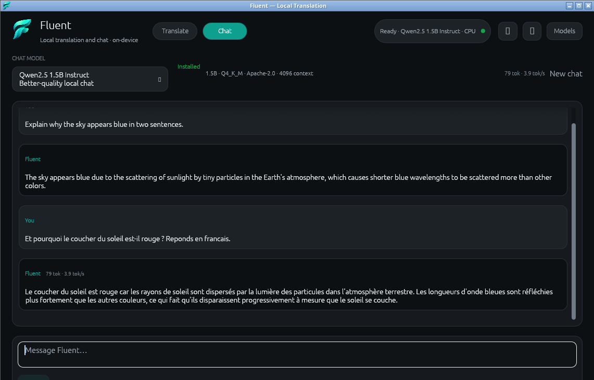
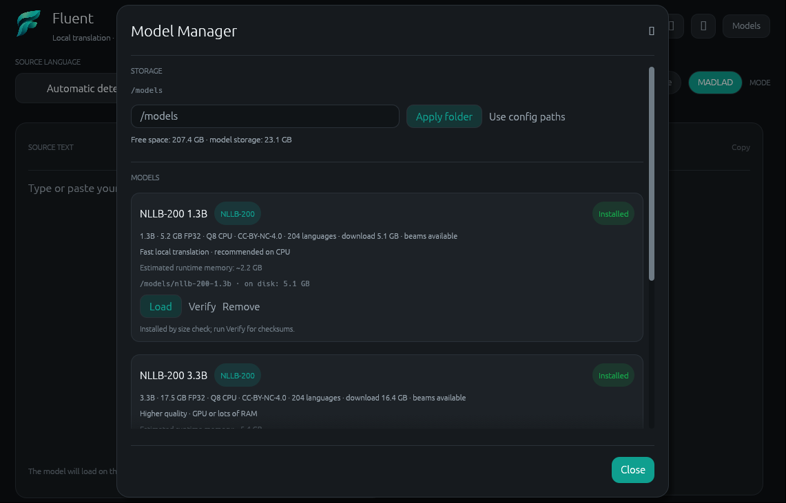
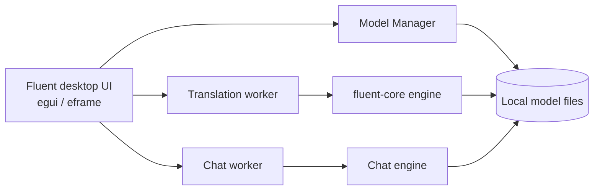
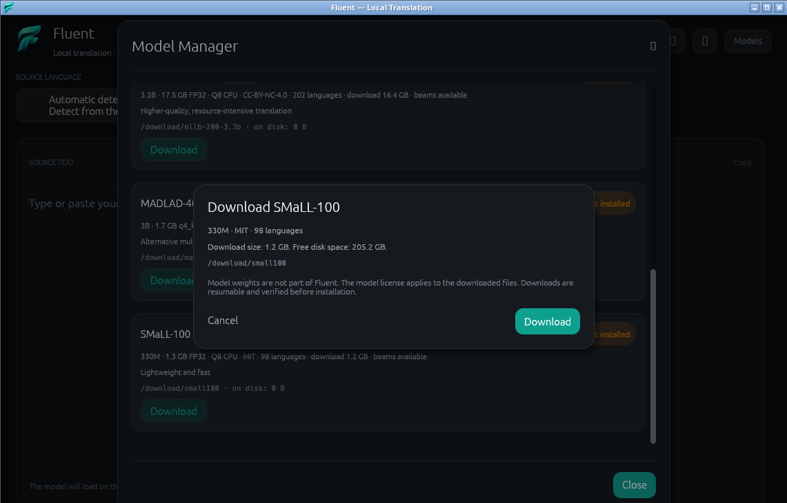
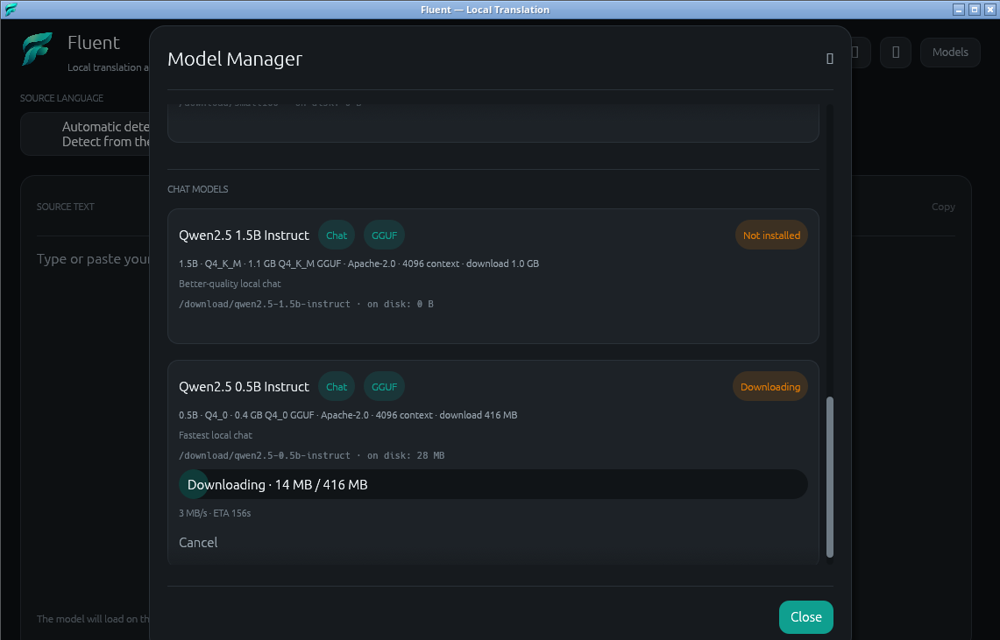

# Fluent

**Local-first translation and local AI chat for your desktop.**

_Release Desktop v0.2.0_

Fluent is a native Rust desktop application that translates text across up to
202 language variants and runs small instruction-tuned chat models on your own
machine. Models are downloaded only when you ask for them, and inference does
not call a remote AI service.

<p align="center">
  
</p>

 [](#status) [](https://www.rust-lang.org/) [](LICENSE) [](#install-fluent)


## Contents

- [What is Fluent?](#what-is-fluent)
- [Screenshots](#screenshots)
- [Features](#features)
- [How Fluent works](#how-fluent-works)
- [Install Fluent](#install-fluent)
- [First launch and model installation](#first-launch-and-model-installation)
- [Translation guide](#translation-guide)
- [Chat guide](#chat-guide)
- [Model reference](#model-reference)
- [Performance and system requirements](#performance-and-system-requirements)
- [Troubleshooting and FAQ](#troubleshooting-and-faq)
- [Privacy](#privacy)
- [Development and contributing](#development-and-contributing)
- [Licence, models and provenance](#licence-models-and-provenance)
- [Documentation index](#documentation-index)

## What is Fluent?

Fluent is a desktop front end for local machine translation and local
instruction-model chat. It is built in Rust with `egui`/`eframe` and runs on
the CPU. The application is deliberately split into two independent
capabilities:

- **Translation** uses multilingual encoder-decoder models: NLLB-200,
  MADLAD-400 or SMaLL-100.
- **Chat** uses a Qwen2.5 Instruct model in GGUF format. Chat models are never
  used for translation, and translation models are never used for chat.

The application itself is small. The models are separate, large downloads with
their own licences and storage requirements. Keeping them separate keeps the
application archive small, lets you choose between speed and quality, and avoids
redistributing weights under unclear terms. Fluent does not bundle model weights
in the application, installer, portable archive or CI artifact.

### Local-first by design

- No account and no cloud translation or chat API are required for inference.
- Translation and chat text is processed on your device.
- Model downloads require network access; after the files are installed,
  translation and chat run offline.
- The application has no telemetry or analytics.
- Chat conversation history is session-only.
- Fluent’s source is MIT-licensed. Each model keeps its own licence; NLLB-200
  is **non-commercial** (CC-BY-NC-4.0).

### What Fluent is not

Fluent is not a cloud service, a mobile app, a model host, or a general-purpose
AI assistant. The current release does not provide:

- persistent chat history;
- tool/function calling, RAG, web access or browsing;
- GPU chat inference;
- a Windows installer, a macOS DMG, an AppImage or a Flatpak;
- physical Windows or macOS runtime validation;
- Intel macOS binaries;
- a public GitHub Release for version 0.2.0.

### Quick start

1. [Install Fluent](#install-fluent) for Linux, Windows or macOS.
2. Open **Models** in the header and download one translation model or one chat
   model. Models are not included in the application archive.
3. Use **Translate** for text translation or **Chat** for local conversation.
   See [First launch](#first-launch-and-model-installation).

## Screenshots

<p align="center">
  <br>
  <em>Translate view. The language pickers are filtered by the selected model.</em>
</p>

<p align="center">
  <br>
  <em>Chat view. Replies stream locally; the French follow-up uses conversation context.</em>
</p>

<p align="center">
  <br>
  <em>Model Manager. Storage, catalogue state, model size, licence and verification live here.</em>
</p>

All screenshots show the Linux build. Layout and fonts may differ slightly on
other platforms.

## Features

### Translation

- **Four translation models** across three families: NLLB-200 1.3B, NLLB-200
  3.3B, MADLAD-400 3B and SMaLL-100.
- **Model-dependent language lists.** NLLB-200 exposes 202 variants, SMaLL-100
  98 and MADLAD-400 72. The source and target selectors only show languages the
  selected model actually supports.
- **Automatic source detection**, or an explicit source language.
- **Simplified and Traditional Chinese** on NLLB-200 and MADLAD-400; SMaLL-100
  maps only Simplified Chinese.
- **Beam search** for NLLB-200 and SMaLL-100; deterministic greedy decoding for
  MADLAD-400.
- **Cancellable loading and generation**, with progress and a visible result
  limit.
- **Output policies**: Automatic, Custom limit and No limit.
- **Copy-friendly results** and keyboard submission with `Ctrl+Enter`.

### Local chat

- **Qwen2.5 1.5B Instruct** for better-quality chat and **Qwen2.5 0.5B
  Instruct** for a lighter, faster option.
- **Streaming replies**, one text delta at a time.
- **Multi-message context** within the current session.
- **Cancellation** while loading or generating.
- **Context truncation notices** and a separate output-limit notice.
- **Independent chat model selection**: changing the chat model never changes
  the translation model.
- **Session-only history**: closing the application clears the conversation.

### Model Manager

- **Remote catalogue** with a pinned, validated schema.
- **Model details** including family, size, licence, language count and
  recommended use.
- **Progress, speed and ETA** during downloads.
- **Resumable downloads** using a `.part` file.
- **SHA-256 verification** and atomic promotion.
- **Cancellation** without presenting a partial model as installed.
- **Verify and Repair** actions for an existing installation.
- **Safe removal** confined to the selected managed model directory.
- **Custom storage root** for users who keep models on another disk.

### Desktop experience

- Native window, turquoise Fluent mark and platform icons.
- Light, dark and system themes with selectable accent colours.
- Searchable language pickers and explicit model names.
- Keyboard shortcuts (`Ctrl+Enter`, `Esc`, `Enter`, `Shift+Enter`) and
  labelled controls. A formal screen-reader audit has not been performed.
- Application-only archives: no model weights, configuration or user data.

## How Fluent works



### Application and models are separate

Installing Fluent does not install a model. The application starts without any
model and shows guidance in Translate and Chat. You then use the Model Manager
to inspect, download and verify a model. The same split applies to updates and
uninstallation: application files can be replaced without touching the model
directory, and removing a model does not remove the application.

### One heavyweight model at a time

Translation and chat use separate workers and separate engines. Switching to
Chat unloads the translation engine; switching to Translate unloads the chat
engine. Only one heavyweight model is intentionally resident at a time.

After an unload, the operating system allocator may keep freed memory mapped in
the process. That is allocator behaviour, not a second model still running. See
[Performance and system requirements](#performance-and-system-requirements)
for the measured evidence.

### Model lifecycle

```text
Not installed
    │ Download
    ▼
Downloading ──Cancel──► Not installed (partial .part retained)
    │ Complete
    ▼
Verifying (size + SHA-256)
    │ Pass                    │ Fail
    ▼                         ▼
Installed                  Needs repair / Incomplete
    │ Load (first use or Load now)
    ▼
Loaded
    │ Switch view / Unload / Remove
    ▼
Installed
```

The Model Manager performs a cheap size check when it lists models. A download
is promoted only after the required files pass SHA-256 verification. An
existing directory may show **Installed** after the size check; use **Verify**
for the full checksum pass, which reports **Installed · verified**.

## Install Fluent

### Status

**Fluent Desktop v0.2.0 is released.**

Download the archive for your platform from the [Fluent v0.2.0 GitHub Release](https://github.com/NeonMC23/Fluent/releases/tag/fluent-desktop-v0.2.0).

| Platform | Release archive | Runtime validation |
|---|---|---|
| Linux x86-64 | `Fluent-v0.2.0-linux-x86_64.tar.gz` | **Validated** on physical Linux and in CI |
| Windows x86-64 | `Fluent-v0.2.0-windows-x86_64.zip` | CI build and packaged self-tests pass; physical GUI/runtime testing not performed |
| macOS Apple Silicon | `Fluent-v0.2.0-macos-aarch64.zip` | CI build and bundle smoke test pass; physical GUI/runtime testing not performed |

All three release archives are accompanied by SHA-256 checksums and detached Minisign signatures. The project's public verification key is available in the release assets and at [`docs/keys/minisign.pub`](docs/keys/minisign.pub).

### Verify your download

Before extracting an archive, verify its checksum and Minisign signature.

Install [Minisign](https://jedisct1.github.io/minisign/) if it is not already available.

First, verify the SHA-256 checksum using the `SHA256SUMS` file supplied with the release:

```bash
sha256sum -c SHA256SUMS
```

Then verify the signature of the archive you downloaded:

```bash
minisign -Vm Fluent-v0.2.0-linux-x86_64.tar.gz -p minisign.pub
```

Replace the archive name with the Windows or macOS filename when verifying another platform.

The release signatures use public key ID `B504F2189BB21013`. Always obtain the public key from the official repository or release assets. A checksum detects accidental corruption; a valid signature also authenticates the archive against the project's signing key.

### Linux (x86-64, glibc 2.35 baseline)

The Linux archive is an application-only `tar.gz` containing `bin/fluent`, `LICENSE` and `README.txt`.

Requirements:

- Linux x86-64 with glibc 2.35 or newer.
- X11 or Wayland.
- An OpenGL 3.3-capable driver.
- Typical desktop runtime libraries, including `libxkbcommon`, `fontconfig` and the X11/Wayland libraries used by `winit` and `glutin`.

1. Download `Fluent-v0.2.0-linux-x86_64.tar.gz` and its corresponding `.minisig` file, together with `SHA256SUMS` and `minisign.pub`, from the [GitHub Release](https://github.com/NeonMC23/Fluent/releases/tag/fluent-desktop-v0.2.0).
2. Verify the checksum and signature as described above.
3. Extract and launch Fluent:

```bash
tar -xzf Fluent-v0.2.0-linux-x86_64.tar.gz
cd fluent-0.2.0-linux-x86_64
./bin/fluent
```

4. Install models using **Models** in the application header. See [First launch](#first-launch-and-model-installation).

For desktop-menu integration, Fluent also provides a per-user source installer. It does not require root privileges:

```bash
git clone https://github.com/NeonMC23/Fluent.git
cd Fluent
./install.sh
```

The default installation layout is:

```text
~/.local/lib/fluent/fluent                  application binary
~/.local/bin/fluent                         launcher
~/.config/fluent/config.json                configuration
~/.config/fluent/settings.json              preferences
~/.local/share/fluent/models/               models
~/.local/share/applications/io.fluent.Fluent.desktop
```

`XDG_CONFIG_HOME`, `XDG_DATA_HOME`, `XDG_STATE_HOME` and `XDG_BIN_HOME` are respected.

The installer preserves existing configuration and models, never uses `sudo`, and never downloads model weights. Uninstallation also preserves configuration and models:

```bash
./uninstall.sh
```

See [docs/LINUX.md](docs/LINUX.md) for dependencies, installer options, migration and troubleshooting.

### Windows (x86-64, portable ZIP)

1. Download `Fluent-v0.2.0-windows-x86_64.zip` and its `.minisig` signature from the [GitHub Release](https://github.com/NeonMC23/Fluent/releases/tag/fluent-desktop-v0.2.0).
2. Verify the archive using `SHA256SUMS`, `minisign.pub` and Minisign.
3. Extract the ZIP and run `fluent.exe`.
4. Install models using **Models** in the application header.

The archive is portable: no installer, Start Menu shortcut or uninstaller is provided.

The executable is **not signed with Authenticode**. There is no paid code-signing certificate or established SmartScreen reputation, so Windows may display an unknown-publisher warning. Only run archives obtained from the official release and successfully verified.

**Physical Windows GUI/runtime validation has not been performed.** CI builds the executable and runs the packaged `--version` and `--self-test` checks, but does not exercise the GUI through a physical Windows desktop or OpenGL session.

See [docs/WINDOWS.md](docs/WINDOWS.md).

### macOS (Apple Silicon, arm64)

1. Download `Fluent-v0.2.0-macos-aarch64.zip` and its `.minisig` signature from the [GitHub Release](https://github.com/NeonMC23/Fluent/releases/tag/fluent-desktop-v0.2.0).
2. Verify the archive using `SHA256SUMS`, `minisign.pub` and Minisign.
3. Extract the archive and open `Fluent.app`.
4. Install models using **Models** in the application header.

The application is **not signed with an Apple Developer ID and is not notarized**. Gatekeeper may warn about or block the first launch. If you trust the archive and have verified its signature, use the standard macOS privacy settings to allow that specific application. Do not disable Gatekeeper globally.

**Physical macOS GUI/runtime validation has not been performed.** CI validates the ARM64 bundle, its metadata and Mach-O architecture, and performs a bundle smoke test. Intel Macs and universal binaries are not supported by this release.

See [docs/MACOS.md](docs/MACOS.md).

### Building from source

Prerequisites:

- Rust and Cargo. The workspace requires Rust 1.85 or newer; the validated release builds use Rust 1.99.0.
- A C/C++ toolchain, `pkg-config` and `cmake`.
- Linux: X11/Wayland development headers, OpenGL development libraries and `fontconfig`.
- Windows: Visual Studio 2022 Build Tools with the Desktop development with C++ workload and the Windows SDK.
- macOS: Xcode Command Line Tools.

Build and run:

```bash
cargo build --release --locked -p fluent-gui
./target/release/fluent
```

For platform-specific dependencies and instructions, see [docs/LINUX.md](docs/LINUX.md), [docs/WINDOWS.md](docs/WINDOWS.md) and [docs/MACOS.md](docs/MACOS.md).

## First launch and model installation

Fluent starts even when no model is installed. Translate shows the selected
translation model and a “not installed” message; Chat shows the selected chat
model and an **Open Models** action.

1. **Launch Fluent.** The header switches between **Translate** and **Chat**.
2. **Open Model Manager.** Select **Models** in the header, or use
   **Settings → Manage models…**.
3. **Review storage.** The platform-native default root is shown with free
   space and total model usage. If a populated model directory from an older
   portable layout is detected, Fluent uses it without moving files and shows a
   notice. To use another disk, enter a folder and click **Apply folder**.
   Existing models are **not moved**. **Use config paths** returns to the paths
   in `config.json`. A storage folder inside a Git repository is rejected.
4. **Choose a model.** Cards show the display name, architecture, parameter
   count, download size, licence and a short description.
5. **Review the confirmation.** The dialog shows the exact download size, free
   disk space, destination and licence note.
6. **Download.** Progress shows downloaded bytes, total size, speed, ETA and a
   **Cancel** action. Downloads use a `.part` file and resume from the existing
   bytes when possible.
7. **Wait for verification.** Downloaded files are checked against pinned
   sizes and SHA-256, then promoted atomically. A failed or cancelled download
   is never presented as installed. Existing/manual directories start with a
   size check; **Verify** performs the full checksum pass.
8. **Load the model.** Translation loads on the first translation, or with
   **Load now**. Chat loads on the first message. The status changes to
   **Ready** when the engine is loaded.
9. **Switch models.** Changing the translation model clamps the language pair
   to the new model’s capabilities and announces the adjustment. Changing the
   chat model starts a new conversation.
10. **Maintain the model.** **Verify** runs the full checksum pass. **Repair**
    requests missing or invalid files. **Remove** deletes only the selected
    managed model directory and asks for confirmation.

Application installation and model installation are separate. A model can be
much larger than Fluent itself: the smallest chat model is about 0.44 GB and
the largest translation model about 17.6 GB.

<p align="center">
  <br>
  <em>Download confirmation. Nothing is downloaded before you confirm.</em>
</p>

<p align="center">
  <br>
  <em>Download progress. Interrupted downloads can be resumed from the same card.</em>
</p>

## Translation guide

1. Select **Translate**.
2. Choose a translation model in the **Model** selector. If it is not installed,
   use **Open Models** first.
3. Choose a source language, or leave **Automatic detection** enabled.
4. Choose a target language. The picker is filtered to the selected model.
5. Enter or paste text. **Clear** removes the source; **Clear all** also clears
   the result.
6. Click **Translate** or press `Ctrl + Enter`.
7. Read the result, then use **Copy** when needed.

Loading and generation show progress. Use **Cancel** or `Esc` while a task is
running. Switching views is blocked until an active translation is finished or
cancelled.

### Language coverage

| Model | Supported Fluent variants | Notes |
|---|---:|---|
| NLLB-200 1.3B | **202** | Broadest coverage; beam search |
| NLLB-200 3.3B | **202** | Same language table; higher quality and memory cost |
| MADLAD-400 3B | **72** | Curated, tokenizer-verified subset; greedy decoding |
| SMaLL-100 | **98** | Fast, small; Simplified Chinese only |

Language counts are not quality guarantees. A model can support a language and
still produce weak output for a particular domain. Model quality also differs
by direction and sentence length. See [docs/BENCHMARKS.md](docs/BENCHMARKS.md).

### Chinese and Cantonese

| Model | Simplified Chinese | Traditional Chinese | Cantonese / Yue |
|---|---|---|---|
| NLLB-200 | Yes (`zho_Hans`) | Yes (`zho_Hant`) | Yes (`yue_Hant`) |
| MADLAD-400 | Yes (`zho_Hans`) | Yes (`zho_Hant`) | Not offered |
| SMaLL-100 | Yes (`zho_Hans`) | **No** | **No** |

The selectors use the same capability registry as the engine. A saved language
that is unsupported by a newly selected model is adjusted at switch or startup,
and the interface announces the change.

### Output limits

| Mode | Behaviour |
|---|---|
| **Automatic** (default) | Derives a finite budget from the input, capped at 512 generated tokens for translation. Short inputs finish sooner. |
| **Custom limit** | Uses the configured maximum even if the model has not emitted EOS. |
| **No limit** | Generates until EOS, cancellation, an inference error or the model’s positional capacity. NLLB has a 1024-position table; MADLAD has no fixed positional cap, so time and memory are the practical limits. |

The default maximum source length is 512 tokens. Longer input is truncated
explicitly and reported. NLLB’s position table allows up to 1024 source
positions, but the application keeps a 512-token default for predictable
latency. Very long “No limit” generations require more memory and time; this is
not infinite hardware capacity.

MADLAD uses deterministic greedy decoding and does not expose beam search.
NLLB and SMaLL-100 use the configured beam count (default 4).

## Chat guide

1. Select **Chat** in the header.
2. Choose **Qwen2.5 1.5B Instruct** (default, better quality) or
   **Qwen2.5 0.5B Instruct** (lighter and faster).
3. If the model is not installed, open **Models → Chat models** and download it.
4. Type a message in **Message Fluent…** and press `Enter`, or use **Send**.
   `Shift + Enter` inserts a new line.
5. The reply streams into the conversation. Use **Cancel** while generating.
6. Continue the conversation to use prior messages as context.
7. Use **New chat** to clear the session immediately.
8. Switch to **Translate** when you want to translate. The chat engine is
   unloaded; returning to Chat shows **Chat model not loaded** until the next
   message reloads it.

### Chat limits

| Limit | Value |
|---|---:|
| Prompt plus generated context | **4096 tokens** |
| Maximum generated tokens per reply | **512 tokens** |
| History persistence | **None** (session-only) |

When the conversation exceeds the prompt budget, older turns are dropped first
and the interface reports that older turns were omitted. If one message is
still too long, Fluent keeps the beginning of the message and appends the
assistant suffix. Reaching the 512-token reply limit is reported separately.

### Chat quality

Both Qwen models are compact. They can be fluent, helpful and wrong:
factual errors, invented details and weak reasoning are possible, especially in
the 0.5B model and on detailed science or current-events questions. Verify
important claims independently. Chat does not have tool calling, retrieval,
web access, vision or a knowledge base.

Decoding is deterministic greedy with a repetition penalty; there are no
temperature or top-p controls. Chat is CPU-only in the validated release.
Conversation text is not written to `settings.json`, the model directory or any
other file.

## Model reference

All sizes are approximate decimal downloads from the pinned manifests. A model
directory may use slightly different on-disk space depending on the file
system.

**Translation models**

| Model | Family | Download | Languages | Licence | Recommended use |
|---|---|---|---:|---|---|
| **NLLB-200 1.3B** | NLLB-200 | 5.51 GB | 202 | CC-BY-NC-4.0 | Balanced CPU translation; broad coverage |
| **NLLB-200 3.3B** | NLLB-200 | 17.60 GB | 202 | CC-BY-NC-4.0 | Highest-quality NLLB option; large RAM/disk |
| **MADLAD-400 3B** | T5 | 1.68 GB | 72 | Apache-2.0 | Alternative T5 translation; CPU-only, greedy |
| **SMaLL-100** | M2M-100 (12/3) | 1.34 GB | 98 | MIT | Fast, lightweight translation |

Quantization: NLLB-200 uses FP32 checkpoints with CPU Q8 at runtime; MADLAD-400
uses a q4_k GGUF; SMaLL-100 uses FP32 safetensors with CPU Q8 at runtime.

**Chat models**

| Model | Download | Quantization | Context used | Licence | Recommended use |
|---|---:|---|---:|---|---|
| **Qwen2.5 1.5B Instruct** | 1.12 GB | Q4_K_M GGUF | 4096 tokens | Apache-2.0 | Default local chat; better coherence |
| **Qwen2.5 0.5B Instruct** | 0.44 GB | Q4_0 GGUF | 4096 tokens | Apache-2.0 | Fastest local chat; lower quality |

Known limitations:

- **NLLB-200** is non-commercial and can omit clauses or sentences on some
  inputs. The 3.3B model is much more memory-hungry.
- **MADLAD-400** uses a curated 72-language subset, greedy decoding, and can add
  or repeat content. It is slow on CPU.
- **SMaLL-100** does not support Traditional Chinese or Cantonese; its 256-token
  training target means very long outputs are outside its normal range.
- **Qwen2.5** models are CPU-only, compact, and can fabricate facts. Chat
  history and GPU inference are not provided.

### Where models are stored

The active model root is deterministic and independent of the process working
directory:

| Platform | Default model root with no `config.json` |
|---|---|
| Linux | `$XDG_DATA_HOME/fluent/models`, or `~/.local/share/fluent/models` |
| Windows | `%APPDATA%\fluent\Fluent\data\models` |
| macOS | `~/Library/Application Support/io.fluent.Fluent/models` |

- **Installed Linux build:** the installer writes `config.json` with paths under
  the Linux default root.
- **Portable archive or ZIP with no `config.json`:** Fluent uses the
  platform-native default above. It never writes to `/models`, the application
  bundle or an unrelated working directory.
- **Existing portable models:** on Linux and Windows, a populated `models/`
  directory next to the executable or at the archive root is detected and used
  without moving files. A historical `~/.fluent/models` directory is also
  considered. The Model Manager shows that an existing directory was detected.
- **Existing configuration:** the model paths in `config.json` take precedence
  when no custom storage root is set.

A custom storage root changes where Fluent looks for model subdirectories; it
does not move existing files. Each model has its own subdirectory:
`nllb-200-1.3b`, `nllb-200-3.3b`, `madlad400-3b-mt`, `small100`,
`qwen2.5-1.5b-instruct` and `qwen2.5-0.5b-instruct`. Use **Models → Storage**
to see the active root, free space and any detected existing directory.

## Performance and system requirements

### Reference host

These measurements are from the canonical development host, not a universal
guarantee:

- Intel Core i5-11400H (6 cores / 12 threads)
- 15 GiB RAM
- NVIDIA RTX 3050 Laptop, 4 GB VRAM — **not used**
- Nobara Linux 44, CPU-only builds
- Rust 1.99.0, Candle 0.11

### Representative measurements

| Workload | Load time | Resident memory | Generation |
|---|---:|---:|---:|
| Qwen2.5 1.5B chat | ~1.9 s | ~1.95 GB after load; ~2.02 GB peak | 3.3–4.9 s to first output; 4–7 tok/s |
| Qwen2.5 0.5B chat | ~1.0 s | ~0.94 GB after load; ~0.96 GB peak | 2.6–3.2 s to first output; 5–8 tok/s |
| NLLB-200 1.3B, 60-case sample | 9.6 s | 2.29 GB peak | 3.3 s median total; 0.47 s TTFT |
| NLLB-200 3.3B Q8, 60-case sample | 14.8 s | 4.57 GB peak | 5.9 s median total; 0.95 s TTFT |
| MADLAD-400 3B q4_k, 60-case sample | 2.0 s | 2.75 GB peak | 30.2 s median total; 3.0 s TTFT |
| SMaLL-100, 42-case sample | 1.0 s | 0.42 GB after load; 1.67 GB peak | 0.44 s median total; 98 ms TTFT |

In the GUI, the 1.5B chat workload reached about **2.09 GB** RSS and a real
NLLB-200 1.3B translation reached about **1.74 GB**. With forced allocator
trimming, RSS fell to about **0.14 GB** after chat unload and **0.18 GB** after
translation unload; under the default allocator, higher RSS after unload is
retained arena memory, not a resident model.

TTFT and generation speed vary with prompt length. Short chat replies are
prefill-bound: a two-token answer can take several seconds end to end despite a
higher steady-state decode rate. Long chat contexts increase prefill time.
Model size affects both storage and RAM.

### Practical system guidance

These are practical recommendations derived from the measurements above, not
certified minimums:

| Resource | Guidance |
|---|---|
| OS | Linux x86-64 with glibc 2.35+ is validated. Windows 10/11 x86-64 and macOS 12+ arm64 have CI builds only. |
| CPU | x86-64 with AVX2/FMA is preferred; the portable scalar Q8 path remains available. |
| RAM | 8 GB is workable for SMaLL-100, Qwen2.5 0.5B/1.5B and NLLB-200 1.3B. 16 GB is recommended for NLLB-200 3.3B and comfortable multitasking. |
| Disk | Application archives are roughly 7.5–10 MB. Models range from about 0.44 GB to 17.60 GB. |
| GPU | No validated GPU inference. NVIDIA CUDA and Apple Metal are optional build features for some translation paths; chat is CPU-only. |
| Display | X11 or Wayland with an OpenGL 3.3-capable driver on Linux. |

Available RAM matters more than the nominal installed figure: other
applications, the desktop, and the model’s working set all compete for memory.
If RAM is tight, Fluent warns that the system may swap and become very slow.
The model loader also performs a pre-load estimate for supported models.

## Troubleshooting and FAQ

### The model is not installed

Open **Models**, choose the required translation or chat model, review its
licence and size, and download it. Fluent shows **Open Models** in Translate
and Chat when a model is missing.

### The model is installed but not loaded

This is normal after switching views or starting Fluent. Translation loads on
the first translation (or **Load now**); Chat loads on the first message.
**Installed** means the files are present. **Ready** means the engine is loaded.

### A download was interrupted

Click **Download** again. Fluent keeps a `.part` file and resumes from the
bytes already present when the server supports range requests. A cancelled
download remains **Not installed** and shows the partial disk usage.

### Verification or hash check failed

The model is not promoted. Use **Verify** to see the failure, then **Repair** to
request missing or invalid files. A corrupt existing file is preserved with an
`.invalid-<timestamp>` suffix rather than silently deleted. If repair cannot
recover the installation, remove that model and download it again.

### There is not enough disk space

The download confirmation and Model Manager show free space. Free disk space
or choose another storage folder with **Apply folder**. Fluent checks space
before writing and stops with an error if the destination is insufficient.

### A language is missing from the picker

The selector is intentionally filtered by the selected model. NLLB-200 has 202
variants, SMaLL-100 98 and MADLAD-400 72. SMaLL-100 does not offer Traditional
Chinese or Cantonese. Switch models if you need another language.

### The first response is slow

Model loading and prompt prefill happen before the first token. NLLB-200 1.3B
loads in roughly 6–10 seconds on the reference CPU; the 3.3B model takes about
15–21 seconds. Chat TTFT is roughly 3–5 seconds for short prompts. Later tokens
usually arrive faster.

### Long chat conversations are slow

Fluent uses a 4096-token prompt-plus-output budget. Prefill cost grows with the
conversation, and older turns are dropped when the budget is exceeded. Start a
**New chat** for a new topic if the conversation becomes slow.

### The chat answer is wrong or invented details

Both Qwen models are compact and can fabricate facts. Use the 1.5B model for
better coherence, keep questions focused, and verify important claims. Chat is
not a search engine or a substitute for professional advice.

### Memory usage stays high after switching views

The other engine is unloaded, but the system allocator may retain freed memory
in the process. Forced trimming showed RSS falling to about 0.14–0.18 GB after
unload; the higher default value is retained arena memory. If the system is
under pressure, close other applications or restart Fluent.

### Switching between Translate and Chat

Switching views unloads the other heavyweight model. An active translation must
finish or be cancelled before switching. Chat can be cancelled independently.
The chat model remains installed on disk.

### Linux: the binary will not start

Check that the system has glibc 2.35 or newer and an OpenGL 3.3-capable driver.
Run `ldd bin/fluent` to inspect shared-library dependencies. On X11 install the
distribution’s `libxkbcommon-x11` package. The canonical build targets Ubuntu
22.04; other distributions and older glibc versions are not validated.

### Windows: SmartScreen warns about the executable

The ZIP is not Authenticode-signed and has no SmartScreen reputation. Only run
a build you obtained from a trusted source and verified. This project does not
claim that SmartScreen will accept it.

### macOS: Gatekeeper blocks the app

The app is unsigned and not notarized. If you trust the verified build, use the
standard Finder or System Settings flow to allow that specific application. Do
not disable Gatekeeper globally. No notarized build is currently provided.

### Where are models stored?

The default roots are listed in
[Where models are stored](#where-models-are-stored). Use **Models → Storage** to
see the active root and free space, or to choose another folder. Models are not
stored inside the application archive.

### Are conversations saved?

No. Chat history is session-only and is cleared when Fluent closes or when you
select **New chat**. The last translation source text is restored on startup
from `settings.json`; chat messages are not persisted.

### Does Fluent send my text to a server?

No. Translation and chat inference run locally and do not call a remote AI
service. Network access is used only for explicit model downloads, catalogue
refresh and other normal application networking. Your operating system and
other software may still have their own network activity.

## Privacy

- **Local inference.** Text is processed by local model files.
- **No account or API key.** Fluent does not require a cloud account.
- **No telemetry.** The application contains no analytics.
- **Chat is session-only.** No chat text is written to disk.
- **Translation source is restored.** The last source text is stored in
  `settings.json` so the field can be restored on startup; clear it if you do
  not want that local copy.
- **Model downloads are ordinary HTTPS requests** to pinned Hugging Face
  repositories. The model choice and your IP address are visible to that
  service, as with any download.
- **Offline after installation.** Once the required files are present,
  translation and chat do not need a network connection.

Fluent’s local inference does not make the whole machine offline. Your
operating system, drivers and other applications may still communicate over the
network.

## Development and contributing

### Workspace layout

| Path | Purpose |
|---|---|
| `crates/fluent-core` | Translation engines, chat engine, model registry, tokenizers, downloader and catalogue |
| `crates/fluent-gui` | Native `egui`/`eframe` desktop interface |
| `catalogue/` | Versioned remote model catalogue |
| `scripts/` | Packaging, verification, benchmarks and acquisition helpers |
| `docs/` | Technical documentation |
| `benchmarks/` | Committed evaluation corpora and harness inputs |

### Build and test

```bash
cargo build --release --locked -p fluent-gui
cargo test --workspace --locked
cargo clippy --workspace --all-targets --locked -- -D warnings
cargo fmt --all -- --check
```

Installer regression tests:

```bash
bash scripts/test-installer.sh
```

Gated real-model tests require local model paths and are skipped in ordinary
CI:

```bash
FLUENT_TEST_MODEL="$HOME/.local/share/fluent/models/nllb-200-1.3b" \
  cargo test --release -p fluent-core --test reliability -- --nocapture

FLUENT_MADLAD_MODEL="$HOME/.local/share/fluent/models/madlad400-3b-mt" \
  cargo test --release -p fluent-core --test madlad -- --nocapture

FLUENT_SMALL100_MODEL="$HOME/.local/share/fluent/models/small100" \
  cargo test --release -p fluent-core --test small100 -- --nocapture

FLUENT_CHAT_MODEL="$HOME/.local/share/fluent/models/qwen2.5-1.5b-instruct" \
  cargo test --release -p fluent-core --test chat -- --nocapture

FLUENT_TEST_MODELS_ROOT="$HOME/.local/share/fluent/models" \
  cargo test --release -p fluent-core --test model_manager -- --nocapture
```

### Command-line examples

Translate from the core crate:

```bash
cargo run --release -p fluent-core --example translate -- \
  "Hello, how are you?" eng_Latn fra_Latn \
  "$HOME/.local/share/fluent/models/nllb-200-1.3b" cpu auto
```

Run the chat benchmark:

```bash
cargo run --release -p fluent-core --example chat_eval -- \
  --model "$HOME/.local/share/fluent/models/qwen2.5-1.5b-instruct" \
  --id qwen2.5-1.5b-instruct --out /tmp/chat.json
```

Build a portable Linux archive:

```bash
./scripts/package-linux.sh
```

### Contributing

Contributions, bug reports and documentation improvements are welcome through
the repository’s GitHub issues and pull requests. For substantial changes,
open an issue to discuss the approach first. No issue template, CLA or
contribution licence agreement is currently defined in the repository.

Please do not commit model weights, tokenizer assets, credentials, private keys
or build output. See [docs/MODEL_PROVENANCE.md](docs/MODEL_PROVENANCE.md) for
model provenance and [docs/VERSIONING.md](docs/VERSIONING.md) for release and
version rules.

## Licence, models and provenance

Fluent’s source code is distributed under the [MIT License](LICENSE). This does
**not** relicense model weights, tokenizers or brand assets.

| Asset | Licence | Notes |
|---|---|---|
| Fluent source code | MIT | Application code only |
| NLLB-200 1.3B / 3.3B | CC-BY-NC-4.0 | Non-commercial; user-supplied or downloaded after confirmation |
| MADLAD-400 3B | Apache-2.0 | User-supplied or downloaded after confirmation |
| SMaLL-100 | MIT | User-supplied or downloaded after confirmation |
| Qwen2.5 Instruct | Apache-2.0 | User-supplied or downloaded after confirmation |
| Fluent branding | Project-provided | Redistribution rights not independently documented; owner confirmation required |

Fluent does not bundle or redistribute model weights. The Model Manager
downloads only the pinned files listed in the registry, verifies their exact
sizes and SHA-256 values, and stores them outside the application payload.

### Provenance caveats

Two items still require owner review before public distribution:

1. **Historical NLLB assets.** The current working tree contains no NLLB
   weights or tokenizer assets, but earlier Git commits still contain NLLB
   tokenizer/configuration files. A public full-history clone still downloads
   them. Resolving this requires a history decision (sanitized mirror or
   source-only archive); no history rewrite was performed. See
   [docs/RELEASE_INTEGRITY.md](docs/RELEASE_INTEGRITY.md).
2. **Branding rights.** The logo and banner are project-provided. Do
   not assume the MIT source licence covers them; owner confirmation is
   required before public distribution. See [docs/ASSETS.md](docs/ASSETS.md).

Nothing in this document is legal advice. Model licences apply to the model
assets, not to Fluent’s source code.

### Acknowledgements

Fluent builds on open research and open-source software:

- **Meta AI** for NLLB-200 and the original NLLB tokenizer and model cards.
- **Google Research** for MADLAD-400 and its Apache-2.0 GGUF release.
- **Alireza Mohammadshahi and co-authors** for SMaLL-100.
- **Alibaba Qwen** for the Qwen2.5 Instruct models.
- **Hugging Face** for model hosting and the `tokenizers` crate.
- The **Candle** project for the Rust inference primitives.
- **egui / eframe**, **whatlang**, and the wider Rust open-source community.

Model and dependency licences remain with their respective authors. See
[docs/MODEL_PROVENANCE.md](docs/MODEL_PROVENANCE.md) for the project’s model
licence record.

## Documentation index

- [Linux installation and validation](docs/LINUX.md)
- [Windows build and packaging status](docs/WINDOWS.md)
- [macOS build and packaging status](docs/MACOS.md)
- [Platform support matrix](docs/PLATFORM_SUPPORT.md)
- [Model Manager and storage](docs/MODEL_MANAGER.md)
- [Local chat architecture and limits](docs/CHAT.md)
- [Language capability registry](docs/LANGUAGES.md)
- [Model package specification](docs/MODEL_PACKAGE.md)
- [MADLAD-400 setup and measurements](docs/MADLAD.md)
- [SMaLL-100 setup, languages and licence](docs/SMALL100.md)
- [Translation benchmarks](docs/BENCHMARKS.md)
- [Historical CPU optimisation notes](PERFORMANCE.md)
- [Remote catalogue schema](docs/CATALOGUE.md)
- [Model provenance and licensing](docs/MODEL_PROVENANCE.md)
- [Release integrity and historical assets](docs/RELEASE_INTEGRITY.md)
- [Builds, CI artifacts, signing and release verification](docs/RELEASE.md)
- [Fluent 0.2.0 release notes](docs/RELEASE_NOTES.md)
- [Manual GitHub publication procedure](docs/PUBLISHING.md)
- [Versioning](docs/VERSIONING.md)
- [Branding assets](docs/ASSETS.md)
- [Model backend architecture decision](docs/ADR-001-model-backends.md)
- [Changelog](CHANGELOG.md)

---

*Your language. Your machine. Your privacy.*
